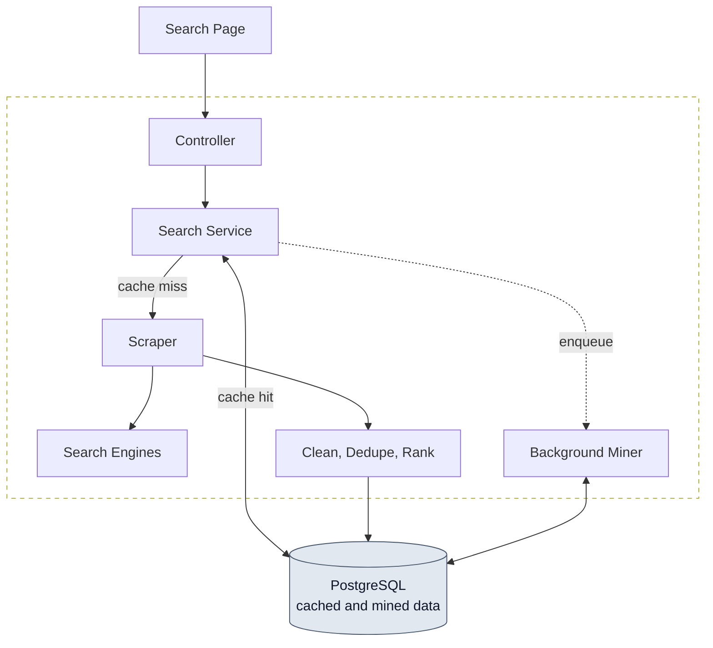

# Yet Another Miner  on the Internet

 
Search aggregator with caching and mining utilities, suggestively with faster and relevant data frames.
 
### Architecture
 

 
- New query goes to the scraper, which fetches from [mentioned](https://example.com) search engines.
- Results are ranked and stored in postgreSQL.
- The background miner keeps drilling down the stored data, branching until met the cache quote.
- Follow-up queries are answered from the database first given the new scraped clump gets a lower ranking.

**Stack:** Java, Spring Boot, Maven, Hibernate, PostgreSQL, Jsoup, Playwright

> To Add:  Ranking mechanism, Anti Bot routes, Testing tools.

### Docs
- `mvn compile exec:java`
